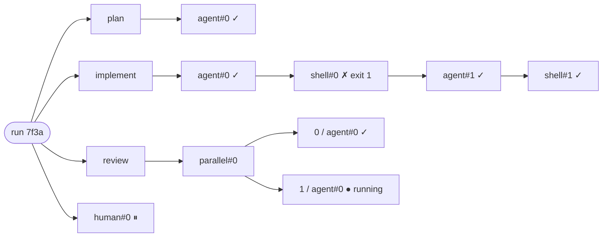
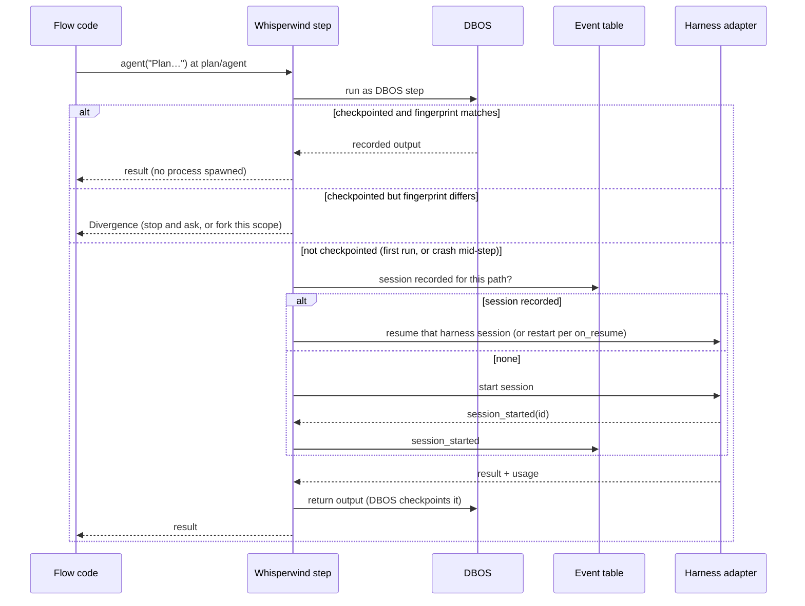
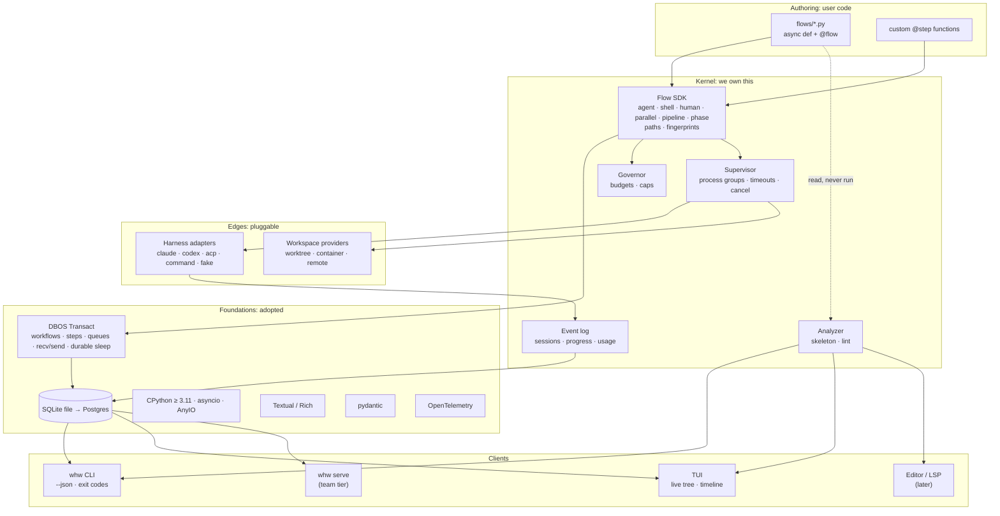
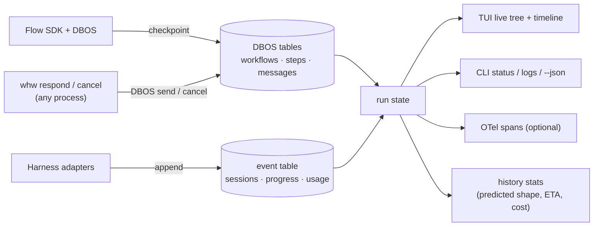
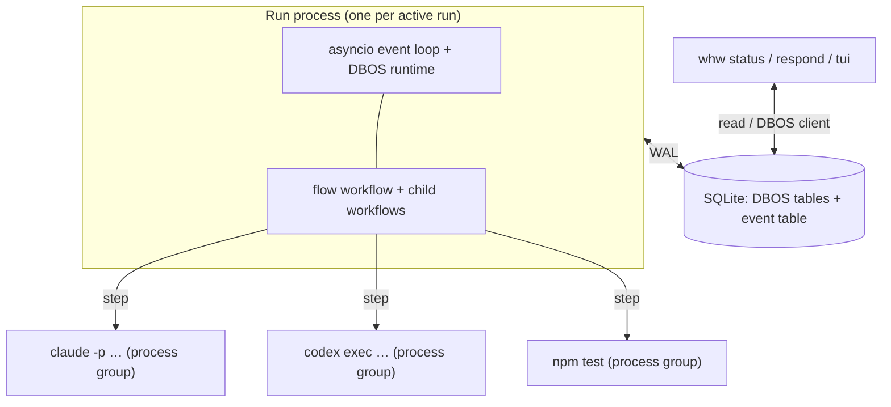
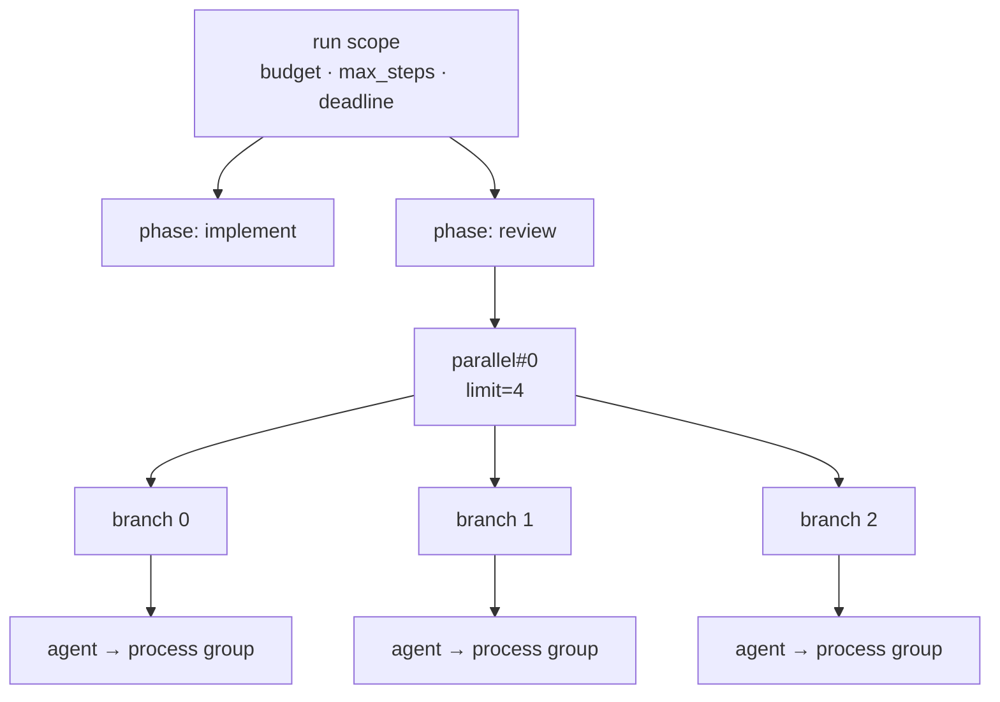
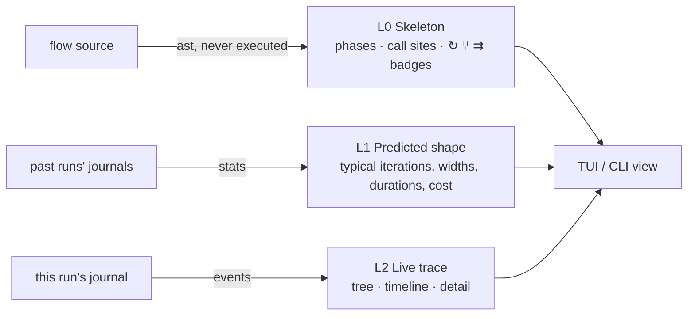
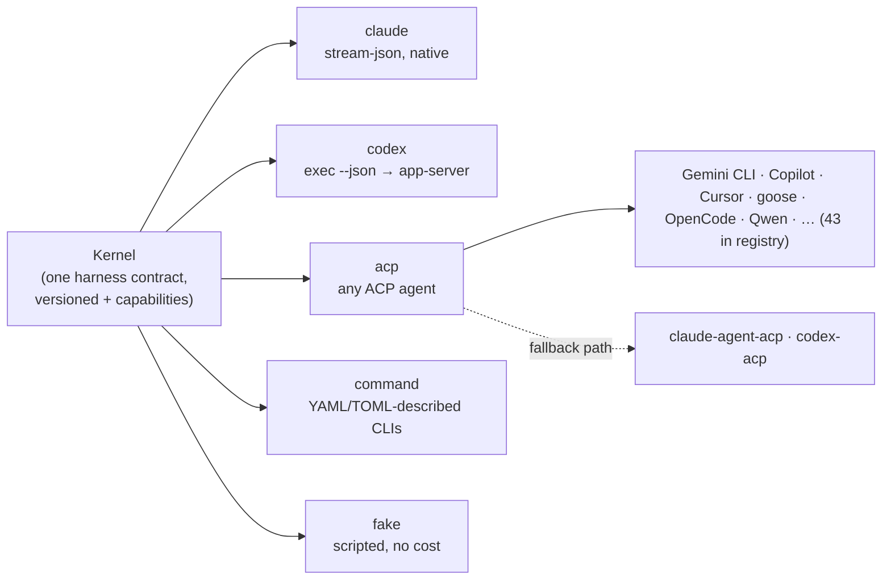
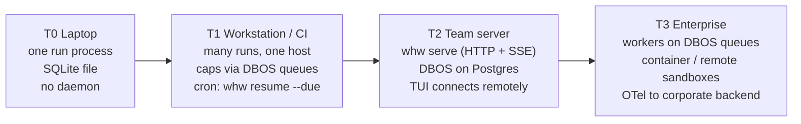
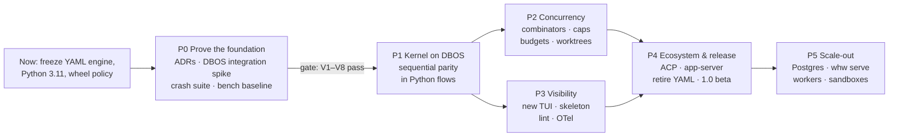

# Whisperwind: vision and roadmap

| | |
|---|---|
| Status | **Direction locked.** D1–D4 in §15 were accepted on 2026-10-24, and the project's documentation is written around this direction. D5–D13 are *Proposed*. |
| Date | 2026-10-24 |
| Scope | Product direction, architecture, foundations, and the phased path to get there |
| Relation to other docs | `README.md` describes Whisperwind as designed here, for users, and its status section says what runs today. This document holds the reasoning: architecture, roadmap and decisions. The code and its tests define what exists. |

---

## Contents

1. [In one page](#1-in-one-page)
2. [Why change](#2-why-change)
3. [North star](#3-north-star)
4. [Principles](#4-principles)
5. [The flow model](#5-the-flow-model)
6. [Architecture](#6-architecture)
7. [Concurrency, parallelism and performance](#7-concurrency-parallelism-and-performance)
8. [Seeing flows: visualization and editing](#8-seeing-flows-visualization-and-editing)
9. [Harnesses](#9-harnesses)
10. [Build on, don't build](#10-build-on-dont-build)
11. [Portability and scale](#11-portability-and-scale)
12. [What happens to today's code](#12-what-happens-to-todays-code)
13. [Roadmap](#13-roadmap)
14. [How we work](#14-how-we-work)
15. [Decisions](#15-decisions)
16. [Risks](#16-risks)
17. [Non-goals](#17-non-goals)
- [Appendix A: research sources](#appendix-a-research-sources)
- [Appendix B: glossary](#appendix-b-glossary)

---

## 1. In one page

**North star.** Whisperwind is the durable, local-first runtime for multi-agent coding flows written in plain Python. One flow can drive any agent harness (Claude Code, Codex, any ACP agent), fan out to many agents at once, wait days for a person, survive any crash, and be watched live from the terminal. The same flow file runs on a laptop with zero infrastructure and on a team's worker pool.

**Five shifts:**

| From (today) | To (north star) |
|---|---|
| Flows are YAML graphs, with a custom expression language, a type language and templates | Flows are `async def` Python functions. Python *is* the expression, template and composition language. |
| One step at a time, with no parallelism | Concurrent by default: structured concurrency, fan-out to hundreds of agents, caps and budgets that hold under parallelism |
| The TUI draws and edits a static graph | The TUI shows a live **call tree and timeline** from the run journal, over a static **skeleton** read from source without running it |
| Built from scratch: parser, expressions, editor, store, step loop | **Adopt proven foundations**: Python, **DBOS Transact** for durable execution, SQLite and Postgres, Textual, pydantic, OpenTelemetry, ACP. **Own only what is agent-specific**: step paths, harness adapters, process supervision, budgets, workspaces and the terminal experience. |
| A JSONL log per run on one machine | DBOS's durable store, a SQLite file locally and Postgres for teams, with DBOS queues as the path to remote workers |

**What stays:** harness-agnostic, terminal-first, CLI as the engine with `--json` and stable exit codes, durable and resumable, bounded by default, human-aware, never calling model APIs directly.

**Accepted decisions** ([§15](#15-decisions)) that shape everything else:
- **D1:** retire YAML.
- **D2:** adopt DBOS as the durable-execution foundation.
- **D3:** drop the pure-Python rule. Any dependency is allowed if it publishes wheels for the tier-1 platforms.
- **D4:** Python ≥ 3.11.

---

## 2. Why change

### 2.1 Static configuration has hit its ceiling

Every capability a flow needs beyond a fixed graph has become a new YAML keyword plus engine code:
- **Loops** need `visits.<id>` counters and `max_visits`.
- **Data-dependent work** needs `map` over a subflow, and that runs one item at a time.
- **Reuse** needs `templates` and `include`.
- **Logic** needs a 687-line expression language, a 379-line type language and `${{ }}` templates.

Each addition is paid for twice: once in the engine and once in the validator and editor.

What agent flows actually look like makes this worse every month:
- "For each failing test, spawn a fixer."
- "Run three reviewers and keep the findings two of them agree on."
- "Loop until the verifier finds nothing new."
- "Race two harnesses and take the first passing answer."

Each is a few lines of ordinary code and a design project in a declarative graph. The market has converged on code: Claude Code dynamic workflows (generally available since May 2026), at least seven open-source re-hosts of that dialect, the LangGraph Functional API, DBOS, Temporal and Pydantic AI all define flows as functions.

Code gives us for free what YAML forced us to build:
- control flow and helper functions;
- libraries and imports;
- type checking (mypy and pyright);
- debuggers;
- unit tests for flows;
- editor support.

### 2.2 We own too much of the stack

About 16,000 lines of Python ship today. Over a third implement things that are not Whisperwind's reason to exist:

| Owned subsystem | Lines | Commodity or core? |
|---|---:|---|
| YAML loading, flow spec, effective form, validation and checks | ~2,300 | Commodity *if* flows are code |
| Expression language, templates and type language | ~1,300 | Replaced by Python itself |
| Round-trip structural editing (CLI and TUI) | ~1,100 | Not needed when structure is code |
| Step loop, routing and node registry | ~1,450 | Replaced by Python control flow plus a scheduler |
| Run store (JSONL events, derived state, locks, inbox) | ~860 | Replaced by DBOS plus a small event table |
| Harness adapters, process supervision, conformance kit | ~2,200 | **Core: this is the product** |

([§12](#12-what-happens-to-todays-code) has the full breakdown.)

Every line we own is a line we must test, document and keep in sync with the README. The rule is simple: **own what is agent-specific, adopt everything else** ([§10](#10-build-on-dont-build)).

### 2.3 The design was sequential at its core

ADR 0007 deferred parallelism and promised that the event log would be ready for it. In practice the runner, budgets, workspaces and TUI all assume one active step. Retrofitting concurrency onto a sequential step loop costs more than designing the kernel concurrent from the first line, and fan-out is now the dominant shape of agent work.

### 2.4 What we got right and keep

Durable runs that survive crashes, bounded runs (budgets, limits and timeouts), first-class human steps answerable from anywhere, harness adapters with a conformance kit, worktree workspaces, a scriptable CLI with stable exit codes, and a TUI. These carry forward unchanged in intent; most of their code carries forward too.

---

## 3. North star

> **Write a coding-agent workflow as a Python function. Run it anywhere, on any harness, at any width. Never lose work. Always see what it's doing.**

### 3.1 The gap we own

| | Code-defined flows | Mixes harnesses in one flow | Durable across crashes and sessions | Mid-run human input | Zero-infra local | Live terminal view | Python |
|---|:-:|:-:|:-:|:-:|:-:|:-:|:-:|
| Claude Code dynamic workflows | ✓ (JS) | ✗ Claude only | ◐ same session only | ✗ | ✓ | ✓ | ✗ |
| Open re-hosts of that dialect | ✓ (JS/TS) | ◐ mostly one per run | ◐ best-effort | ✗ | ✓ | ◐ web | ✗ |
| Worktree managers (Conductor, Sculptor, …) | ✗ human-dispatched | ✓ | ✗ | n/a | ✓ | GUI | – |
| Model-API frameworks (LangGraph, Pydantic AI, ADK) | ✓ | ✗ call model APIs, not harnesses | ✓ | ✓ | ◐ | ✗ | ✓ |
| Durable engines (Temporal, DBOS) | ✓ | ✗ generic | ✓ | ✓ | ◐ | ✗ web UIs | ✓ |
| **Whisperwind (target)** | **✓** | **✓** | **✓** | **✓** | **✓** | **✓** | **✓** |

Each competitor misses at least two columns. Whisperwind builds on one of them, DBOS, for durability, and adds everything agent-specific on top. Whisperwind's moat is the combination: *harness-agnostic × durable × human-aware × local-first × terminal-native*. Vendors will keep improving the single-harness, in-session experience. We should never compete there.

### 3.2 Who it's for

- **Primary.** A developer who lives in the terminal, already pays for Claude Code and/or Codex, and wants repeatable multi-agent workflows: chains, loops, fan-outs and approval gates. They want them without a platform, a web UI or one vendor.
- **Secondary, later.** A team or platform group running those same flows on shared workers, under budgets and audit.

---

## 4. Principles

The original brief's nine principles, revised. Changes are in **bold**.

| # | Principle | Status |
|---|---|---|
| 1 | **A flow is Python code. The durable store is the source of truth for what happened.** | Replaces "the flow file is the source of truth" |
| 2 | The CLI is the engine, and the TUI is a client. Anything the TUI does, the CLI does, with `--json`. | Kept |
| 3 | Don't build an agent. Delegate agent work to harnesses through adapters. | Kept |
| 4 | Structured data between steps: schema-checked agent output, never free-text parsing. | Kept |
| 5 | Durable by default. **Every effect is a journaled step, and resume replays the flow against the journal.** | Kept, new mechanism |
| 6 | Bounded by default. **Budgets, caps and timeouts hold under concurrency.** | Extended |
| 7 | Local-first, zero infrastructure. **No daemon is required at any tier below "team".** | Softened: a server is optional at the team tier |
| 8 | Transparent. Every step is traceable to its harness session. **Telemetry is a projection of the journal, never a side channel.** | Extended |
| 9 | Small kernel, extensible edges. New harnesses, step kinds and workspace providers need no kernel change. | Kept |
| 10 | **Concurrent by default.** Parallelism is designed in, not bolted on. | New |
| 11 | **Adopt proven foundations; own only what is agent-specific.** Building something an existing library does well needs a written justification. | New |
| 12 | **Installs from wheels, never from source.** Every dependency publishes wheels for the tier-1 platforms. | Replaces "pure-Python only" |
| 13 | **Performance is a tested budget, not a hope.** Kernel overhead targets are checked in CI. | New |

---

## 5. The flow model

### 5.1 A flow is an async function

The sketch below is illustrative. Exact names and signatures are settled in an ADR during Phase 0.

```python
from dataclasses import dataclass
from whisperwind import flow, agent, shell, human, parallel, phase, FlowFailed

@dataclass
class Plan:
    summary: str
    steps: list[str]

@dataclass
class Review:
    approve: bool
    issues: list[str]

@flow(phases=["Plan", "Implement", "Review"], budget_usd=5)
async def implement_feature(goal: str, max_rounds: int = 3) -> str:
    """Plan, implement until the tests pass, review twice, ask before committing."""
    with phase("Plan"):
        plan = await agent(f"Plan this change: {goal}",
                           harness="claude", profile="read-only", output=Plan)

    with phase("Implement"):
        for _ in range(max_rounds):
            await agent(f"Implement this plan:\n{plan.steps}",
                        harness="claude", session="impl")   # rounds share one session
            tests = await shell("npm test", check=False)
            if tests.ok:
                break
        else:
            raise FlowFailed(f"tests still fail after {max_rounds} rounds")

    with phase("Review"):
        bugs, security = await parallel(
            agent("Review the diff for bugs", harness="codex", output=Review),
            agent("Review the diff for security issues", harness="claude", output=Review),
        )

    issues = bugs.issues + security.issues
    if await human("Commit?", details=issues, choices=["commit", "stop"]) == "commit":
        await shell(["git", "commit", "-am", plan.summary])
    return plan.summary
```

Run it with `whw run flows/implement.py --goal "add rate limiting"`, or by name, `whw run implement-feature`. The function signature *is* the input schema. Type hints become `--input` validation and `--help` text.

The same flow in today's YAML (`examples/implement-feature.yaml`) needs visit counters, `when:` expressions, `${{ }}` templates and a separate schema file. It also cannot run the two reviews in parallel.

### 5.2 Vocabulary

The vocabulary deliberately matches the de facto dialect from Claude Code dynamic workflows (`agent`, `parallel`, `pipeline`, `phase`, `log`, `budget`), so users and agents already know it. It adds what that dialect lacks: other harnesses, `shell`, `human`, durable `sleep` and user-defined steps.

| Kind | Primitive | What it does | Journaled? |
|---|---|---|:-:|
| **Step** | `agent(prompt, harness=, output=, session=, profile=, workspace=, label=, …)` | One harness turn. `output=` takes a pydantic model, dataclass or TypedDict (schema via pydantic `TypeAdapter`), or a raw JSON Schema dict. | ✓ |
| | `shell(cmd, check=, timeout=, workspace=)` | One command in a process group | ✓ |
| | `human(question, choices=, timeout=, default=)` | Waits for a person, for days if needed, with no process running | ✓ |
| | `sleep(duration)` / `sleep_until(t)` | Durable timer | ✓ |
| | `@step` on any function | User-defined effect, such as calling the GitHub API. Its result is journaled. | ✓ |
| | calling another `@flow` | Subflow as a child scope | ✓ |
| | `now()`, `random()`, `uuid()` | Deterministic on replay | ✓ |
| **Combinator** | `parallel(*steps, limit=)` | Barrier. Returns results in order. A failure surfaces as an `ExceptionGroup` unless `return_exceptions=True`. | scope |
| | `pipeline(items, *stages, limit=)` | Each item flows through the stages with no barrier between stages. **The default for fan-out.** | scope |
| | `race(*steps)` / `first(*steps, until=)` | First result wins and the losers are cancelled (processes killed) | scope |
| | Python `for`, `while`, `if`, `try` | Ordinary control flow | – |
| **Structure** | `with phase("Name"):` | Groups steps for display and addressing. A context manager, not global state. | scope |
| | `label=` | A stable, human-meaningful step name | – |
| **Context** | `budget.remaining()`, `log()`, `run.id`, `run.inputs` | Read-only run context and narrator lines | – |

Primitives, combination and abstraction are all present:
- **Primitive:** a *step*.
- **Combination:** combinators plus Python control flow.
- **Abstraction:** `@flow` names a combination, and a flow is itself callable as a step from another flow.

New capabilities arrive as new step kinds or new combinators, never as a parallel concept with its own lifecycle.

### 5.3 The durability contract

Resume works by **re-running the flow function** and serving completed steps from the durable store. This is **DBOS's model**: workflow functions re-execute on recovery, and checkpointed step outputs are returned instead of re-running the steps. It is not Temporal-style full replay with a sandbox. It asks three things of flow code:

1. **Effects only through steps.** Anything that touches the world (agents, commands, files, network, clocks, randomness) goes through a step primitive or a `@step` function.
2. **Deterministic between steps.** Given the same step results, flow code makes the same calls.
3. **Concurrency only through combinators.** Use `parallel`, `pipeline`, `race` and `map`, not raw `asyncio.create_task` or `gather`, because combinators assign scopes.

**Enforcement is lint plus detection, not a sandbox.** Python cannot be sandboxed cheaply, and Temporal's sandbox is a known source of user pain.
- **Lint.** `whw check flow.py` uses stdlib `ast` to flag `time.time()`, `datetime.now()`, `random`, `subprocess`, raw `asyncio.create_task` and file writes in flow bodies.
- **Detection.** DBOS already raises an error when a recovered workflow calls a different step than the one recorded. Whisperwind adds a **fingerprint** to every step: a hash of its kind, rendered prompt or command, and options. A mismatch on replay is a *divergence*, reported in plain language with the step's path, never silently ignored ([§5.4](#54-step-identity-and-addressing)).

### 5.4 Step identity and addressing

**This is the hardest design problem in code-defined durable flows, and the main thing Whisperwind adds on top of DBOS.**

The prior art handles step identity in three ways:

| Approach | Used by | Failure mode |
|---|---|---|
| Global call order | Claude Code workflows, LangGraph interrupts, pi re-host | One failure mid-fan-out reruns every later sibling. Reordering invalidates everything after the change. |
| Source-hash versioning | DBOS (its *default* application version) | Editing the flow strands every paused run |
| Content hash only | One open-source re-host | Two identical prompts collide |

**Whisperwind: hierarchical paths.** A step's identity is its **path**: the chain of scopes it was called in, plus a per-scope ordinal. The fingerprint is a separate check on top of the path.

**Mapping onto DBOS.** Paths are realized with DBOS primitives rather than a store of our own:
- **Each run is a DBOS workflow** whose workflow ID is the run ID.
- **Each concurrent scope is a child workflow** with a deterministic workflow ID, `<run>/<scope path>`. Concurrent scopes are parallel branches, pipeline items and subflows.
- **Steps inside a scope** are DBOS steps. They are numbered in call order, which is deterministic because code within one scope is sequential.

Two consequences:
- Sibling branches never depend on each other's start order. That removes the deterministic-start-order constraint DBOS places on `asyncio.gather`.
- Whisperwind pins the DBOS **application version** per project rather than using the source hash. Paused runs therefore survive edits, and fingerprints catch the edits that matter.

Phase 0 verifies this mapping ([§13](#13-roadmap)).

```
plan/agent#0                          the planning agent
implement/agent#2                     the third implementation round
implement/shell#2                     its test run
review/parallel#0/1/agent#0           the second reviewer in the first parallel group
audit/pipeline#0/item[src/a.ts]/stage#1/agent#0
                                      stage 2 of the pipeline for item "src/a.ts"
review/security-review                with label="security-review", independent of position
```



Properties:
- **Concurrent siblings are independent.** Each branch has its own scope, so a failure in branch 1 never invalidates branch 3. Completion order does not matter.
- **Edits are local.** Editing a prompt in `review` leaves `plan` and `implement` cached. On resume the first divergent step in a scope is reported:

  ```
  review/parallel#0/1/agent#0: prompt changed since the run paused
  ```

  The user chooses: rerun from there in that scope only (DBOS's fork-from-step on that scope's child workflow), or abort. **Editing a flow while a run is paused is a supported feature, not an accident.**
- **One addressing scheme everywhere.** The same path is the TUI node, the OTel span name, the CLI argument and the key into DBOS (workflow ID plus step number):

  ```
  whw logs @last/review/parallel#0/1
  whw resume @last --from implement
  ```

  Users only ever see paths. DBOS workflow IDs and step numbers are an implementation detail.

Path grammar, escaping and ordinal rules are finalized in an ADR during Phase 0, with a property test for round-tripping.

### 5.5 Resume, step by step



Today's guarantees carry over:
- Completed steps never rerun, because DBOS serves their checkpointed output.
- An in-flight agent step resumes its **harness session** when a session ID was recorded. DBOS re-executes an unfinished step from the start, so the session lookup is what turns "rerun" into "continue". Whisperwind owns this part.
- `on_resume: ask` and `restart` keep their meaning.

### 5.6 Where flows live and how they're shared

- **Discovery.** Flows live in `flows/*.py` in a project, or in an installed package via the `whisperwind.flows` entry point.
- **Sharing.** A flow is shared the way Python is shared: a file, a git repo or a package.
- **Prompts.** Long prompts live in files next to the flow (`prompt("review.md", diff=…)`), which keeps them editable as data ([§8.4](#84-editing-flows-when-structure-is-code)).

---

## 6. Architecture

### 6.1 Layers



### 6.2 Components, one role each

| Component | Its one job | Does **not** |
|---|---|---|
| **Flow SDK** | The user-facing primitives. Turns each call into a DBOS step or child workflow with a path and a fingerprint. | Run processes, store anything itself |
| **DBOS** (adopted) | Durability: checkpoints step outputs, recovers workflows, durable sleep and messages (`recv`/`send`), queues with concurrency limits | Know about harnesses, sessions or budgets |
| **Governor** | Budget reserve-then-settle and the caps DBOS queues don't express (per-workspace writers) | Know what a step does |
| **Event log** | Records what DBOS doesn't: harness session started, progress, usage, pointers to output files | Decide recovery (DBOS does) |
| **Supervisor** | Owns the life of child processes: spawn in a process group, timeout, cancel, kill, reap. Restart policy per step. | Interpret harness output |
| **Harness adapters** | Translate one harness's wire protocol to the harness contract ([§9](#9-harnesses)) | Decide retries or budgets |
| **Workspace providers** | Prepare, hand out and collect a working directory: worktree, container or remote sandbox | Merge or push (flows do that) |
| **Analyzer** | Reads flow source with `ast` and produces the skeleton and lint diagnostics. Never imports or runs the flow. | Execute anything |
| **Projections** | Derive views from the database: run state, CLI status, TUI tree, OTel spans, history stats | Write anything |

### 6.3 One database, two writers, many readers

Durable state lives in **one database**: a SQLite file locally, Postgres for teams. Two writers own disjoint tables:

| Writer | Owns | Source of truth for |
|---|---|---|
| DBOS | Workflow status, step outputs, messages, queues | Whether a step finished and what it returned |
| Whisperwind event log | Session started, progress, usage, output-file pointers, keyed by step path | What is happening right now |

Every view is a projection over both.



- **This is a deliberate tradeoff.** Owning one journal would keep a single event spine. Adopting DBOS means two writers, which we keep coherent by giving them **disjoint facts** and by **keying both by step path**. No fact is written twice. The rule: if DBOS records it, the event log never duplicates it.
- **High-volume agent output never enters the database.** Raw harness streams, stdout and stderr go to per-step files under the run directory, and the event table holds pointers to them. This keeps recovery fast and the database small. Temporal's 50 MB history cap shows what happens otherwise.
- **Requests from other processes** (answers, cancels) go through DBOS (`send`, cancel), not a side channel.

### 6.4 Process model



- **One OS process per active run** executes the flow workflow. User flow code runs **in-process**: it is trusted code from the user's repository, the same trust level as a Makefile.
- **Isolation is for agents, not flows.** Agents run in process groups inside workspaces. Sandboxing belongs to workspace providers, not to Python.
- **A run waiting on a person has no process.** It ends with exit code 4. Answering it resumes it in the background, as today.
- **No daemon.** Durable timers (`sleep`, human timeouts) are applied by `whw resume --due` from cron or CI at the local tiers, and by `whw serve` at the team tier.
- **Open question for Phase 0.** DBOS normally recovers *every* pending workflow of an executor when it launches. Under "one process per run, no daemon", each run process must recover **only its own run**. We need to verify how DBOS's executor IDs and recovery controls support this, and how several processes behave on one SQLite file.

---

## 7. Concurrency, parallelism and performance

### 7.1 Structured concurrency is the execution model

Every step runs inside a **scope**. Scopes nest the way the code nests, so the run is a supervision tree.



- **Durable scopes are DBOS child workflows** ([§5.4](#54-step-identity-and-addressing)). Fan-out is dispatched through **DBOS queues**, which enforce concurrency limits across processes. Inside one process the code is asyncio. DBOS supports `async` workflows and steps, and Textual also runs on asyncio, so the TUI and the engine share a loop model.
- **AnyIO inside steps.** The supervisor uses AnyIO cancel scopes (level-triggered cancellation, `fail_after` / `move_on_after`) for process lifetimes and timeouts. Flow authors write plain `async def` and never see AnyIO or DBOS.
- **Cancelling a scope cancels its subtree.** The scope's child workflows are cancelled in DBOS, and every child process in the subtree gets SIGINT, then a grace period, then SIGTERM, then SIGKILL on the process group, as today.
- **Failures propagate as data up the tree.** A failed branch fails its scope according to the combinator's policy: `parallel` raises an `ExceptionGroup`, `pipeline` marks the item failed, and `race` ignores losers. The failure is recorded before it propagates, so the TUI sees it as an event, not as a crash.

How DBOS cancellation and AnyIO cancel scopes compose (cancelling a child workflow while its step holds a process group) is a Phase 0 verification item.

### 7.2 Resource governance

| Cap | Scope | Why | Default (to be set by benchmarks) |
|---|---|---|---|
| Concurrent steps per combinator | `limit=` argument | Local control over fan-out | unbounded within run cap |
| Concurrent agents per run | run | Subscriptions and rate limits | 8 (Claude workflows default to 16) |
| Concurrent agents per harness, per host | across all runs on a machine | One Claude subscription shared by every run | per-harness config |
| Writers per workspace | workspace | Two agents editing one tree corrupt each other | 1 |
| Budget (USD, tokens) | run, phase, step | Bounded by default | $25 per run, as today |

**Concurrency caps map onto DBOS queues.** Each harness gets a queue whose global `concurrency` limit holds across every run and process sharing the database, with `worker_concurrency` limiting one process. There are no lease rows and no daemon. Workspace-writer exclusivity and budgets are not queue-shaped, so the Governor owns them.

**Budgets under parallelism use reserve-then-settle.**
1. Before a step starts, the Governor reserves its per-step cap, or an estimate when no cap is set.
2. If reservations would exceed what remains, the step waits or fails, by policy.
3. On completion, the reservation is replaced with the actual spend.

This avoids today's failure mode, multiplied by N: each harness's own cap is checked only after a response, and measured overshoot was 5× ([research, Sept 2026](#appendix-a-research-sources)). The invariant, pinned by a property test: *total spend never exceeds the budget by more than the largest single in-flight step's overshoot.*

### 7.3 Workspaces under parallelism

- Parallel agents that **write** default to **one git worktree per branch**. Read-only agents share the base tree.
- Merging stays the flow's job, done with `shell("git …")` or a future helper. Whisperwind never merges or pushes on its own.
- The `Workspace` provider interface (`prepare`, `spawn`, `collect`) is defined in Phase 2 because three implementations are already foreseeable: worktree, container and remote sandbox ([§11](#11-portability-and-scale)).

### 7.4 Performance budgets

The engine is I/O-bound: agents run for minutes. "Fast" therefore means three things:
- **Instant CLI.**
- **Negligible per-step overhead,** even at hundreds of concurrent steps.
- **A TUI that never lags the run.**

Targets are proposals to confirm with the Phase 0 benchmark baseline.

| Metric | Today | Target | How measured |
|---|---|---|---|
| Non-TUI command cold start (`whw status`) | ~260 ms (`whw --help`, Python 3.14) | ≤ 100 ms | timed in CI; lazy-import Textual (it alone costs ~230 ms) |
| Overhead per step (DBOS checkpoint + event append) | not measured | ≤ 10 ms p95 | fake harness bench |
| Queue dispatch latency (DBOS on SQLite polls; there is no LISTEN/NOTIFY) | not measured | ≤ 1 s p95 | fake harness bench |
| Concurrent agent steps in one run | 1 | ≥ 200 with event-loop lag ≤ 50 ms p99 | fake harness bench |
| Steps per run supported | 200 (default limit) | 10,000 (the limit stays configurable) | bench |
| Recovery of a run with 1,000 completed steps | n/a | ≤ 1 s | bench |
| Event → TUI on screen | file polling | ≤ 250 ms | TUI pilot test |
| `whw` process memory with 50 agents in flight | not measured | ≤ 150 MB RSS (harness processes excluded) | bench |

**How these stay true:**
- A benchmark suite runs in CI on the fake harness, with no processes and no cost.
- Each target is an invariant test with a tolerance.
- A regression fails the build rather than being noticed later.

---

## 8. Seeing flows: visualization and editing

Code-defined flows cannot be drawn exactly before they run. Loop counts, fan-out widths and branches depend on data. LangGraph documents its Functional API as "can't be visualized" for exactly this reason. Every mature system pairs a **declared skeleton** with a **runtime trace**: Temporal, Burr, Claude Code's `meta.phases` with `/workflows`, and Dagger's live span tree. Whisperwind does the same in three layers.

### 8.1 Three layers



| Layer | Source | Runs user code? | Shows |
|---|---|:-:|---|
| **L0 Skeleton** | stdlib `ast` over the flow module, plus same-module helpers one level deep | **Never** | The literal `@flow` metadata (name, phases, inputs from the signature). Every `agent`, `shell` and `human` call site with its literal label and source span. Badges for loop ↻, branch ⑂ and fan-out ⇉×?. Opaque boxes for calls it can't resolve. Lint diagnostics. |
| **L1 Predicted** | Statistics from the last N runs of this flow | Never | Ghost nodes: "usually 2 rounds, 4 m, $0.80". ETA and cost estimate before you press run. |
| **L2 Live** | Journal events keyed by step path | Observes only | The real call tree (run → phase → scope → step), a waterfall timeline of parallel work, and per-step detail (prompt, streaming output, result, cost, session ID) |

The step path ([§5.4](#54-step-identity-and-addressing)) is what lets the layers line up: a live step pins onto its skeleton call site, and history aggregates by path.

**Rule: preview never executes the flow.** Dry runs with stubbed effects (Prefect's approach) still execute user code between steps, and they show only one path. We don't offer them as a preview. A dry run on the fake harness remains available as an explicit, labeled test tool.

### 8.2 The TUI

Layout target. The interaction model borrows from Claude Code `/workflows` (phase → agent → detail drill-down), Turborepo (select a task to see only its log, with interactive stdin for human steps), the Temporal timeline (retry badges, live/pause) and Dagger (collapse finished spans).

```
┌ run 7f3a · implement-feature · ● running · $1.82 / $5.00 · 12m 04s ─────────────────────┐
│ ▾ Plan                     ✓   1m12s  │ Plan       ████                                  │
│   ✓ agent#0     claude     $0.21      │ Implement      ██████████████▓▓▓▓                │
│ ▾ Implement  ↻ 2 of ≤3     ●          │  agent#0       █████                             │
│   ✓ agent#0     claude     $0.44      │  shell#0            █                            │
│   ✗ shell#0     exit 1                │  agent#1             ██████▓▓▓▓                  │
│   ● agent#1     claude     $0.31 …    │ Review                                           │
│ ▸ Review     ⇉ ×2 (usually 2)  ○      │                                                  │
│ ? human#0    Commit?           ○      │                                                  │
├───────────────────────────────────────┴──────────────────────────────────────────────────┤
│ implement/agent#1 · claude · session 9c2e… · Editing src/limits/middleware.ts            │
│ > Running npm test -- limits                                                             │
└ ↑↓ select  ⏎ detail  l logs  a answer  p pause  x cancel  r rerun step  / filter  ? help ┘
```

| Screen | Content |
|---|---|
| Runs | Active, waiting and recent runs across the project, with cost, status and age. Filters. The "needs you" inbox comes first. |
| Run | Live tree, timeline and detail pane (above). Answer human steps inline. Pause, cancel, or rerun a step or scope. |
| Flow | L0 skeleton with the L1 overlay, lint results and inputs form. Run from here. |
| Step | Prompt, streaming output, structured result, usage, session ID. Hand off to an interactive harness session. |

Every action in the TUI has a CLI equivalent (`whw status --watch`, `whw logs -f <path>`, `whw graph flow.py`, `whw respond`). The TUI stays a client.

### 8.3 Exports

- `whw graph flow.py --format text|mermaid|json` prints the skeleton.
- `whw status <run> --format mermaid|json` prints the actual run tree.
- **OpenTelemetry** (optional `whisperwind[otel]` extra): the journal is projected into spans using the GenAI semantic conventions (`invoke_agent`, `execute_tool`). The semconv version is pinned because those conventions are still in Development status. This gives Langfuse, Grafana, `otel-tui` and any corporate tracing backend for free.

### 8.4 Editing flows when structure is code

**The TUI stops being a structural graph editor.** That is a real loss, and ADR 0002 rejected Python flows for exactly this reason. It is answered by moving write-back to places where it is safe:

| What you edit | How | Safety |
|---|---|---|
| Prompts | Prompt files (`prompts/review.md`) next to the flow. The TUI opens them in `$EDITOR` or edits them inline. | Data file: always safe |
| Literal arguments (model, harness, limits, a short prompt) | Surgical edit of a **literal** at its `ast` source span, then re-parse to verify. Refused when the argument isn't a literal. | Exact-span replacement: no reformatting, comments kept |
| Structure (add a review step, change a loop) | **Agent-assisted.** The TUI captures intent, launches an agent to edit the flow, and shows the diff. `whw check` and a fake-harness test run before you accept. | A human approves a diff |
| Everything | Your editor, with optional LSP support (pygls, later). It adds code lenses ("▶ run from here", "last run: 3 rounds, 4 m") and the lint as diagnostics. | Your normal workflow |

---

## 9. Harnesses

### 9.1 One contract, many adapters

The adapter contract from ADR 0011 survives: `start`, `resume` and `fork` a session, a stream of normalized events, a final result (text, structured output, usage, cost, session ID), cancel, an optional interactive handoff, and declared **capabilities** with graceful degradation. Two things are added:
- a **version** on the contract;
- event names aligned with ACP's `session/update` vocabulary, so the ACP mapping is near-identity.



| Adapter | Status | Direction |
|---|---|---|
| `claude` | Shipped | Keep driving `claude -p --output-format stream-json` directly. The Agent SDK is now allowed (D3), but it bundles its own CLI binary. Evaluate it in P4 for its permission callbacks, which could route approval prompts to `human` steps. |
| `codex` | Shipped (`exec --json`) | Move to `codex app-server` (JSON-RPC) for fork and mid-turn interrupt once its stability is confirmed. Pin versions and generate the schema from the binary. The official Python SDK (`openai-codex`) drives app-server but bundles a pinned CLI; prefer the user's installed CLI unless that proves worse. |
| `acp` | Not built | Build it on the versioned contract in P4. It covers every ACP agent in one move. Target ACP v1 stable methods and watch the v2 draft. Use a small hand-written, conformance-tested JSON-RPC client, or the official Python SDK once it reaches 1.0 (1.0.0rc3 shipped 2026-10-12). Issues #10–#12 record the design of an earlier implementation on the old engine: a `_meta` extension carrying the full adapter contract, and two-way transcript replay in the conformance kit. |
| `command` | Shipped | Keep, for any CLI that prints JSON lines |
| `fake` | Shipped | Keep. The basis of every engine test and benchmark. |

**Why not make ACP the only contract?**
- Claude and Codex, the two harnesses that matter most, speak ACP only through adapters. Those adapters sit on top of the same native surfaces we already drive.
- ACP has no first-class schema-constrained final answer that we could find.
- Native surfaces give exact cost, forking and schema-validated output.

ACP is the **breadth** strategy; native adapters are the **depth** strategy.

**Structured output** uses the harness's native schema enforcement when available (`--json-schema`, `--output-schema`). Otherwise Whisperwind prompts for JSON, validates the result (pydantic for typed outputs, fastjsonschema for raw schemas) and retries, as `engine/structured.py` does today.

**The conformance kit** (recorded streams, `whw adapter test`, `--live`) stays the gate for every adapter. Harness CLIs change monthly, and recorded-stream tests are how we notice.

---

## 10. Build on, don't build

### 10.1 The rule

> **Adopt the commodity layers. Own only what makes Whisperwind Whisperwind.**

Before building anything, run the **adopt checklist**:

1. **Does a maintained library do this well?** Look for releases in the last 6 months, real adoption and a clear owner.
2. **Is its license compatible?** MIT, Apache-2.0, BSD or MPL are fine for dependencies. BSL, SSPL or proprietary are acceptable only as an external service the user chooses.
3. **Does it meet the dependency policy?** Wheels for every tier-1 platform, a compatible license, an acceptable footprint. See [§10.4](#104-dependency-policy).
4. **Can we wrap it thinly,** in less than about 10% of the lines it saves, without leaking its concepts across our kernel?
5. **If we build instead, why?** Write the reason in an ADR. Acceptable reasons: it is the product's differentiator, nothing adequate exists, or adopting would break a principle we chose to keep.

### 10.2 Layer by layer

| Layer | Decision | Choice | Notes |
|---|---|---|---|
| Flow language | **Adopt** | Python itself (`async def`) | No DSL, no expression language, no template language |
| **Durable execution** | **Adopt** (D2) | **DBOS Transact** (MIT) | Workflows, checkpointed steps, recovery, durable sleep, `recv`/`send`, queues with global concurrency limits, fork-from-step. See [§10.3](#103-the-durable-kernel-adopt-dbos). |
| Concurrency | **Adopt** | asyncio (DBOS-native) + AnyIO 4.x inside the supervisor | Trio is rejected (incompatible with Textual's loop). uvloop is rejected (it doesn't help subprocess-bound work). |
| Local storage | **Adopt** | SQLite through DBOS (its system database), plus our event table in the same file | JSONL stays as an export format |
| Team storage | **Adopt** (Phase 5) | Postgres through DBOS | A configuration change, not a second backend we write |
| Work queue (team tier) | **Adopt** (Phase 5) | DBOS queues | Remote workers dequeue from the shared Postgres |
| Structured output types | **Adopt** | pydantic v2 (`TypeAdapter` for dataclasses and TypedDicts) | Generates JSON Schema for harnesses and validates results. Replaces in-house schema code. |
| Raw JSON Schema validation | **Adopt** (keep) | fastjsonschema | For flows that pass a schema dict |
| Internal data model | **Adopt** | stdlib `dataclasses` (`slots`, `frozen`); pydantic at the boundaries | |
| TUI | **Adopt** (keep) | Textual 8.x + Rich | The timeline widget is custom: rows of Rich segments |
| Static analysis | **Adopt** | stdlib `ast` for the skeleton and lint; libcst for lossless source edits | |
| Graph layout | **Adopt** (keep, optional) | grandalf | Only for the static skeleton. The live view is a tree and needs no layout engine. |
| Telemetry | **Adopt** | OpenTelemetry SDK + OTLP exporter (extra) | Check how much DBOS's own OTel tracing covers before projecting our own spans |
| Harness wire protocols | **Adopt; SDKs where they earn it** | Claude stream-json, Codex app-server, ACP | Official SDKs are now allowed (D3). Adopt one when it removes owned code without forcing a bundled harness binary over the user's installed CLI ([§9](#9-harnesses)). |
| Config format | **Adopt** | TOML via stdlib `tomllib` (3.11+) | Lets us drop ruamel.yaml if YAML flows retire (D10) |
| Distribution | **Adopt** | `uv tool install` and pipx, uv-managed Python, container image | The `.pyz` retires (it can't carry compiled code). PEX per platform as an optional single-file channel. |
| Editor support | **Adopt** (later) | pygls | |
| **Step paths, fingerprints, divergence UX** | **Own** (on DBOS) | – | The differentiator ([§5.4](#54-step-identity-and-addressing)) |
| **Process supervision, harness-session resume** | **Own** (keep) | – | No engine provides it |
| **Harness adapters + conformance kit** | **Own** (keep) | – | The product |
| **Budgets, caps, human delivery, workspaces** | **Own** (keep) | – | Agent-specific |

### 10.3 The durable kernel: adopt DBOS

**Decision (D2, accepted 2026-10-24): adopt DBOS Transact as the durable-execution foundation.**

This was the single largest build-vs-adopt call. The research ran DBOS end to end on SQLite: crash, recover, fan-out through a queue, and a human wait via `send`/`recv`. It worked.

| | Adopt DBOS (chosen) | Own a thin SQLite journal (rejected) |
|---|---|---|
| What it is | A mature MIT library: checkpointed steps, recovery, durable sleep and messages, queues, fork-from-step. SQLite by default, Postgres for scale. Monthly releases. | An event-sourced journal we write and prove correct ourselves |
| Correctness risk | DBOS's, battle-tested | Ours: crash windows, leases, idempotency |
| Time to durable concurrency | Shorter | Longer |
| Scale-out | Built in: Postgres, many processes, queues | A second backend and a queue to build |
| Step identity | Call order within a workflow. Whisperwind maps paths onto child workflows ([§5.4](#54-step-identity-and-addressing)). | Hierarchical paths natively |
| Editing a flow while paused | Pin the application version; fingerprints catch divergence | Native |
| Live agent events | A small event table beside DBOS's tables ([§6.3](#63-one-database-two-writers-many-readers)) | One spine |
| Dependencies | `psycopg[binary]`, greenlet, SQLAlchemy (allowed by D3) | stdlib only |

**What we still own on top of DBOS:**
- step paths and fingerprints;
- harness-session resume;
- process supervision;
- budgets;
- workspaces;
- the terminal experience.

DBOS knows nothing about agents, and that is the right split.

**Phase 0 verifies the integration before Phase 1 builds on it.** Each item below is a pass/fail check, not a bake-off:

| # | Must hold | Why it matters |
|---|---|---|
| V1 | Child workflows with caller-chosen IDs start concurrently from an async workflow on SQLite | The path mapping |
| V2 | A run process can recover only its own run (executor IDs / recovery controls), and several run processes can share one SQLite file safely | No-daemon process model ([§6.4](#64-process-model)) |
| V3 | A pinned application version lets an edited flow resume; DBOS's step-mismatch error and our fingerprints together report divergence by path | Edit-while-paused |
| V4 | `recv` with a multi-day timeout survives the process exiting and is answered by `send` from another process | Human steps |
| V5 | Fork-from-step on a child workflow reruns one scope without touching siblings | "Rerun this scope" |
| V6 | Cancelling a child workflow reaches the step holding a process group, so the supervisor can kill it | Cancel-subtree |
| V7 | SQLite queue dispatch latency and per-step overhead meet [§7.4](#74-performance-budgets) | Performance |
| V8 | The crash-injection suite passes ([§14.3](#143-testing-strategy)) | Correctness of *our* integration |

**If a must-have fails and upstream can't fix it,** the fallback is a thin owned journal that copies DBOS's semantics. Its shape is in the rejected column above. Two things never change either way: the flow API and the step paths. That keeps the fallback contained.

**Vendor note.** DBOS's fleet manager, Conductor, is proprietary. Whisperwind depends only on the MIT library and never requires Conductor.

### 10.4 Dependency policy

**Decision (D3, accepted 2026-10-24): the pure-Python rule is retired.** It protected installability in restricted enterprises and enabled the `.pyz`, but it blocked most of the ecosystem: DBOS, pydantic, libcst, every official harness SDK and the ACP SDK.

**The new rule: any dependency is allowed if it installs from wheels, never from source, on every tier-1 platform:**
- manylinux x86_64
- manylinux aarch64
- macOS arm64
- Windows amd64, once D11 adds Windows

| Check | How |
|---|---|
| Wheels exist for every tier-1 platform | A CI job installs with `--only-binary :all:` on each platform. This replaces today's purity check (`purity.py` and its CI job). |
| License is compatible | MIT, Apache-2.0, BSD, MPL or LGPL (as a library). BSL and SSPL are never runtime dependencies. |
| Footprint stays small | Track total installed size and `whw` cold start in CI ([§7.4](#74-performance-budgets)). A dependency that blows either budget needs an ADR. |
| Heavy or optional integrations stay optional | Extras (`[otel]`, `[server]`, `[container]`, `[e2b]`, …), so the default install stays small |

**What this costs:**
- The `.pyz` zipapp, replaced by `uv tool install`, a container image and optional per-platform PEX files.
- Platforms without wheels (musl/Alpine without musllinux wheels, ppc64le/s390x).
- Air-gapped mirrors that curate wheels one by one.

The research found no evidence that "compiled code blocked" is a common enterprise policy. Artifactory and Nexus proxies cache wheels, and policy gates target CVEs and licenses.

---

## 11. Portability and scale

### 11.1 Same flow, four tiers



| Tier | Execution | State | Coordination | Workspaces | Install |
|---|---|---|---|---|---|
| T0 | In-process | SQLite file (DBOS + events) | – | Worktrees | `uv tool install whisperwind` |
| T1 | One process per run | Shared SQLite file | DBOS queues (global concurrency) | Worktrees | same |
| T2 | `whw serve` + local workers | Postgres (DBOS + events) | DBOS queues | Worktrees, containers | `whisperwind[server]`, container image |
| T3 | Remote workers dequeue runs | Postgres | DBOS queues | Containers, remote sandboxes (e2b, Modal, …) | image + extras |

**Invariant across tiers: the flow file doesn't change.** Tiers change *where* steps run and *where* the journal lives, never what a flow says. A flow tested on the fake harness on a laptop is the flow that runs on the worker pool.

**Escape hatch for organizations that already run Temporal:** a backend adapter in which Whisperwind steps become Temporal activities. Evaluate this after Phase 5. Never put it on the critical path.

### 11.2 Runtime and platform baseline

- **Python ≥ 3.11 (D4).** 3.10 reached end of life on 2026-10-01. 3.11 brings `TaskGroup`, `asyncio.timeout`, `ExceptionGroup`, `tomllib` and a faster interpreter. Revisit 3.12 in 2027. The documented install path is a uv-managed Python, which decouples users from their system interpreter (stock macOS still ships 3.9).
- **Startup.** Lazy-import Textual and other heavy modules so non-TUI commands stay ≤ 100 ms. PEP 810 lazy imports (3.15) make this cheaper later.
- **Platforms.** Linux and macOS are supported. Windows needs process-tree kill through Job Objects (via `ctypes`) and its own CI. That is decision D11.
- **Free-threading and subinterpreters: not needed.** The workload waits on subprocesses. Revisit only if flow-code isolation becomes a goal.
- **Language: stay all-Python.** A Rust or Go core would buy nothing measurable for subprocess-bound work, would split the stack across two runtimes, and would mean a rewrite. If a hosted multi-tenant control plane ever becomes a goal, the realistic split is a compiled *server* talking to Python *workers* over the queue.

---

## 12. What happens to today's code

Line counts are from `src/whisperwind/` on `main`, 2026-10-24 (16,184 lines total). Tests total about 8,400 lines.

| Fate | Lines | Modules | Notes |
|---|---:|---|---|
| **Keep and port** | ~4,300 | `adapters/*`, `engine/process.py`, `workspaces.py`, `budget.py`, `environment.py`, `structured.py`, `human.py`, `respond.py`, `agent.py`, `shell.py`, `python.py`, `handoff.py`, `notify.py`, `conformance/*`, `redact.py`, `clock.py`, `testing.py`, `jsonschemas.py`, `exitcodes.py`, `output.py`, `config.py`, `problems.py` | Node executors become step implementations. The adapter contract gains a version. `human.py` and `respond.py` move onto DBOS `recv`/`send`. Whether the virtual-clock test loop still works under DBOS is a Phase 0 check. |
| **Rework** | ~4,400 | `cli/*` (except editing), `tui/*` (except editor), `render.py`, `runinfo.py` | Same commands and exit codes, re-based on the journal and step paths. TUI screens rebuilt around the live tree and timeline. |
| **Replace** | ~2,400 | `engine/runner.py`, `engine/subflow.py`, `store/*` | Replaced by DBOS workflows, steps, queues and messages, plus the small event table. Subflows become child workflows. Event concepts carry over to the event table. |
| **Retire** | ~5,100 | `purity.py` (replaced by the wheel check), `expr.py`, `templates.py`, `rendering.py`, `schema.py`, `flowspec.py`, `flow.py`, `yamlio.py`, `edit.py`, `checks.py`, `graph.py`, `validate.py`, `units.py`, `engine/routing.py`, `engine/registry.py`, `engine/nodes.py`, `engine/inputs.py`, `cli/editing.py`, `tui/editor.py` | Python replaces the format, expression and editing layers. Some `checks.py` lints return as `ast` lints. |

**Discarded work.** An ACP adapter built on the old engine (~840 lines) was never merged. It was discarded on 2026-10-24 rather than ported, and the ACP adapter is built on the new kernel in P4 ([§9.1](#91-one-contract-many-adapters)).

**YAML flows.** The recommendation (D1) is to retire them, not to keep them as a second front-end. Two authoring formats would double validation, documentation and testing, and would keep the format and expression layers alive.
- The five examples are rewritten by hand in Phase 1 as the parity test.
- If the project has external users with YAML flows, ship a one-shot `whw migrate flow.yaml` that emits Python and is then deleted one release later.
- Until then the YAML engine is **frozen**: bug fixes only, no features.

---

## 13. Roadmap

Phases have **exit criteria, not dates.** A phase is done when its criteria verify, not when time runs out.



| Phase | Scope | Exit criteria (verifiable) |
|---|---|---|
| **Now** | Freeze YAML engine features. Raise `requires-python` to 3.11. Replace the purity CI check with the tier-1 wheel check. Retire the `.pyz`. | CI green on 3.11+ with the wheel check. The README's install section matches what CI builds. |
| **P0 Prove the foundation** | Write ADRs for accepted D1–D4. Settle D5–D13. **DBOS integration spike:** path → child-workflow mapping, per-run recovery, pinned versions, `recv`/`send`, fork, cancellation, on the fake harness. Crash-injection suite. Benchmark harness with baseline numbers. | ADRs written. V1–V8 ([§10.3](#103-the-durable-kernel-adopt-dbos)) pass, or a failed item has an upstream fix or a recorded fallback decision. Bench numbers recorded. |
| **P1 Kernel on DBOS** | `@flow`, `agent`, `shell`, `human`, `sleep`, `@step`, `phase`, `log`, subflows. DBOS-backed durability and resume, plus the event table. Budgets and limits. `claude`, `codex`, `fake` and `command` adapters on the new kernel. CLI `run`, `resume`, `status`, `logs`, `respond`, `cancel`, `list`, `gc`. `whw check` (lint). Examples rewritten in Python. README status updated for the new kernel. | All five examples pass on the fake harness. Crash-at-every-step resume test passes. A live smoke test of one example on Claude and on Codex. README matches behavior (docs test). |
| **P2 Concurrency** | `parallel`, `pipeline`, `race`, `map`. Scope cancellation. Run, harness and host caps. Budget reserve-then-settle. Auto-worktree for parallel writers. `Workspace` provider interface. | Performance targets ([§7.4](#74-performance-budgets)) green in CI. A 200-way fan-out on the fake harness. Property test: budget overshoot ≤ the largest single in-flight step. Cancel-subtree test: no orphan processes. |
| **P3 Visibility** | TUI rebuilt: runs, run (tree, timeline, detail), flow (skeleton + history), step. Inline human answers. `whw graph flow.py`. L1 history overlay. `[otel]` extra. | TUI snapshot tests for each screen. Event-to-screen latency ≤ 250 ms in a pilot test. Skeleton golden tests over the example corpus. Spans validate against the pinned semconv. |
| **P4 Ecosystem & release** | ACP adapter on the versioned contract. Codex app-server adapter. Flow packages via entry points. Agent-assisted flow editing from the TUI. Retire the YAML engine (with `whw migrate` if needed). Optional pygls LSP. | Conformance kit green for every adapter. YAML code deleted. A release tagged as the new major version's beta. |
| **P5 Scale-out** | Postgres through DBOS configuration, with the event table on Postgres too. `whw serve` (HTTP + SSE; TUI remote mode). Remote workers on DBOS queues. Container workspace provider. Remote sandbox extras. | The same example flows pass on SQLite and Postgres (shared suite). Kill-a-worker test: the run resumes on another worker. Extras install on all four tier-1 platforms. |

**First slice (inside P0).** One `@flow` with `agent` and `shell` in a loop, on the fake harness, running on DBOS with SQLite. Kill the process at every checkpoint and event write, resume, and assert the same result with no completed step run twice. Then repeat with a `parallel` fan-out. Everything else builds on this proving correct.

---

## 14. How we work

### 14.1 Decisions are written down

- **This document is the north star.** It changes only when direction changes, and every change is a reviewed commit.
- **ADRs return** (`docs/adr/`) for each decision in [§15](#15-decisions) and for every *own instead of adopt* call ([§10.1](#101-the-rule) step 5). They are short: context, decision, consequences, alternatives.
- **The README describes Whisperwind as designed, and its status section says what runs today.** A change that makes something real, or changes user-visible behavior, updates the README in the same commit.

### 14.2 Adopt first, spike before committing

- Every new capability starts with the adopt checklist ([§10.1](#101-the-rule)).
- Big bets get a **spike with explicit pass/fail criteria** before code lands on `main`: the DBOS integration (V1–V8) and the Codex app-server.

### 14.3 Testing strategy

| Tier | What | Notes |
|---|---|---|
| Behavior | Scenario-named tests through the public surface: the flow SDK, the CLI with `--json` and exit codes, the TUI pilot | One file per public subsystem. The fake harness and virtual clock make them instant and free. |
| Pipeline | End-to-end runs of the example flows on the fake harness | The parity bar for every phase |
| Crash injection | Kill the run at every checkpoint and event write, resume, and compare | **Proof that our integration with DBOS is correct.** Runs in CI. |
| Properties | Path grammar round-trip; budget overshoot bound; "no step completes twice"; replay is idempotent | hypothesis is already a dev dependency |
| Conformance | Recorded harness streams per adapter, plus opt-in live runs | Existing kit |
| Invariants (performance) | The [§7.4](#74-performance-budgets) targets as tolerance tests | Fail the build on regression |
| Live | Real harnesses, opt-in, costs money | Existing `live` marker |

### 14.4 Small slices

Each commit does one thing and leaves the build green. The kernel lands in reviewable slices (DBOS wiring, then paths, then fingerprints, then each primitive), never as one large drop. The old and new engines coexist on `main` until P4 deletes the old one; the new kernel is reachable behind `whw run <file>.py`.

---

## 15. Decisions

D1–D4 were **accepted** by the owner on 2026-10-24. D5–D13 are **Proposed**: the owner accepts, amends or rejects each one in Phase 0. Every accepted decision gets an ADR.

| # | Decision | Status | Choice or recommendation | Main alternative | Reverses |
|---|---|---|---|---|---|
| **D1** | How flows are authored | **Accepted** | Python `async def` + `@flow`. Retire YAML (frozen now, deleted in P4). | Keep YAML as a second front-end | ADR 0002 |
| **D2** | Durable execution | **Accepted** | **Adopt DBOS Transact.** Whisperwind's paths map onto child workflows. Phase 0 verifies V1–V8. | Own a thin SQLite journal (the fallback) | ADR 0012 (mechanism) |
| **D3** | Dependency policy | **Accepted** | **Pure-Python rule retired.** Any dependency that installs from wheels on every tier-1 platform. The `.pyz` retires. | Pure core with compiled extras | ADR 0001 (dependency rule) |
| **D4** | Python floor | **Accepted** | **3.11**; revisit 3.12 in 2027 | 3.12 now | ADR 0001 (version) |
| **D5** | Concurrency model | Proposed | DBOS child workflows and queues for durable fan-out. asyncio in flows; AnyIO cancel scopes inside the supervisor. | AnyIO everywhere, or raw `TaskGroup` only | ADR 0007 |
| **D6** | Event table | Proposed | One small Whisperwind table in DBOS's database, keyed by step path, holding only facts DBOS doesn't record. JSONL as an export format. | A separate event store (a second database) | – |
| **D7** | Harness strategy | Proposed | Own versioned contract; native claude and codex; generic ACP built on the new kernel; adopt official SDKs case by case | ACP as the only contract | – |
| **D8** | Visualization and editing | Proposed | **L0 skeleton + L1 history + L2 live; the TUI is not a structural editor** | Dry-run tracing for previews | ADR 0002 (TUI editing) |
| **D9** | Daemon | Proposed | **None required through T1; `whw serve` optional at T2+** | A local background daemon | ADR 0008 (softened) |
| **D10** | Config format | Proposed | **TOML** (`.whisperwind/config.toml`, stdlib `tomllib`), dropping ruamel.yaml | Keep YAML config | – |
| **D11** | Windows | Proposed | **Defer to P4**; design supervision so Job Objects fit | Support from P1 | – |
| **D12** | Expose Whisperwind to agents (MCP server or ACP agent: "start a flow from inside Claude") | Proposed | **Defer**: revisit after P4 | Build in P3 | – |
| **D13** | Versioning | Proposed | The pivot ships as a **new major version**; 0.1.x YAML line gets fixes only | Gradual minor releases | – |

---

## 16. Risks

| Risk | Likelihood | Impact | Mitigation |
|---|---|---|---|
| Users violate the determinism contract and get confusing resumes | High | Medium | `whw check` lint, fingerprint divergence errors in plain language, `now()`/`random()` provided, docs with examples of each mistake |
| DBOS's model doesn't fit the no-daemon, one-process-per-run model (recovery scope, several processes on one SQLite file) | Medium | High | V2 in the Phase 0 spike; raise it upstream; the fallback is an owned journal behind the same flow API |
| Mapping paths onto child workflows has rough edges (cancellation, fork scope, overhead per child) | Medium | Medium | V1, V5 and V6 in the spike; keep the mapping in one module so it can change without touching flows |
| DBOS changes direction, slows down, or pushes features into proprietary Conductor | Low | High | Depend only on the MIT library; pin versions; the integration surface is small and covered by the crash suite |
| Two writers (DBOS tables and the event table) drift apart | Medium | Medium | Disjoint facts by rule ([§6.3](#63-one-database-two-writers-many-readers)), both keyed by path, and a property test that each projection agrees with DBOS status |
| Dependency footprint grows (DBOS brings SQLAlchemy, psycopg-binary, greenlet) | Medium | Low | Track installed size and cold start in CI; lazy-import DBOS for read-only commands |
| Loss of TUI structural editing disappoints users | Medium | Medium | Prompt files, literal-span edits, agent-assisted diffs (§8.4) |
| Vendors ship multi-harness or durable workflows natively | Medium | High | Stay where vendors won't go: cross-vendor, local-first, human-aware, Python, scriptable. Interoperate (ACP, OTel, MCP) rather than compete. |
| Concurrency multiplies cost and conflicts (budget overshoot, worktree collisions) | High | High | Reserve-then-settle budgets, per-harness caps, one writer per workspace, property tests |
| Harness CLIs and ACP v2 change under us | High | Medium | Versioned contract, conformance kit with recorded streams, pinned versions, capabilities |
| Rewrite stalls with two engines on `main` too long | Medium | Medium | YAML engine frozen now. Phase exit criteria. P4 deletes the old engine. |
| Scope creep toward enterprise features before the local experience is excellent | Medium | Medium | Tiers are sequential. P5 starts only after P4 ships. |
| Python startup feels slow next to native tools | Low | Low | Lazy imports, measured target ≤ 100 ms |

---

## 17. Non-goals

- **Calling model APIs or building an agent.** Harnesses do agent work.
- **Sandboxing flow code.** Flows are trusted project code. Agents get isolated workspaces.
- **A visual drag-and-drop flow editor.**
- **A web UI in the core.** A web client of `whw serve` may come later as a separate client.
- **A general-purpose data or ETL orchestrator.** Steps are coarse agent, command and human work.
- **Hosting Whisperwind as a service.**
- **Re-implementing a distributed scheduler.** Beyond the Postgres queue, scale-out uses adopted infrastructure or a backend adapter.

---

## Appendix A: research sources

Research was done on 2026-10-24, building on the September 2026 Stage 1 research. Versions and claims were checked against primary sources where possible.

**Code-defined agent workflows**
- Claude Code dynamic workflows: https://code.claude.com/docs/en/workflows · launch: https://claude.com/blog/introducing-dynamic-workflows-in-claude-code
- Claude Managed Agents workflow runs (event model reference): https://platform.claude.com/docs/en/managed-agents/workflow-runs
- Re-hosts: https://github.com/xz1220/open-dynamic-workflows · https://github.com/six-ddc/codex-dynamic-workflows · https://github.com/rphang/opencode-workflows
- LangGraph Functional API (and why it can't be visualized): https://docs.langchain.com/oss/python/langgraph/functional-api
- Pydantic graph and durable execution integrations: https://pydantic.dev/docs/ai/graph/ · https://pydantic.dev/docs/ai/integrations/durable_execution/overview/
- Mastra suspend/resume: https://mastra.ai/docs/workflows/snapshots · Google ADK 2.0: https://adk.dev/2.0/ · lionagi: https://github.com/khive-ai/lionagi

**Durable execution**
- DBOS configuration, workflows and upgrading: https://docs.dbos.dev/python/reference/configuration · https://docs.dbos.dev/python/tutorials/workflow-tutorial · https://docs.dbos.dev/python/tutorials/upgrading-workflows
- Temporal limits, sandbox and CLI dev server: https://docs.temporal.io/workflow-execution/limits.md · https://docs.temporal.io/develop/python/python-sdk-sandbox · https://docs.temporal.io/cli/server
- Restate license: https://github.com/restatedev/restate/blob/main/LICENSE · Hatchet Lite: https://docs.hatchet.run/self-hosting/hatchet-lite · Inngest self-hosting: https://www.inngest.com/docs/self-hosting
- Absurd: https://lucumr.pocoo.org/tags/announcements · Prefect pause/resume: https://docs.prefect.io/v3/develop/pause-resume

**Harnesses and protocols**
- Claude Agent SDK (Python): https://code.claude.com/docs/en/agent-sdk/python
- Codex non-interactive mode, app-server and SDK: https://learn.chatgpt.com/docs/non-interactive-mode · https://learn.chatgpt.com/docs/app-server · https://learn.chatgpt.com/docs/codex-sdk
- Agent Client Protocol updates and registry: https://agentclientprotocol.com/updates · https://agentclientprotocol.com/get-started/registry · Python SDK: https://github.com/agentclientprotocol/python-sdk/releases

**Visualization**
- Prefect visualize (limits of stubbed tracing): https://docs.prefect.io/v3/how-to-guides/workflows/visualize-workflow-structure.md
- Flyte conditionals: https://www.union.ai/docs/v1/flyte/api-reference/flytekit-sdk/flytekit.core.condition/page.md · PyTorch graph breaks: https://docs.pytorch.org/docs/main/user_guide/torch_compiler/compile/programming_model.common_graph_breaks.html · JAX control flow: https://docs.jax.dev/en/latest/control-flow.html
- Temporal timeline: https://temporal.io/changelog/updated-event-history-timeline-view-is-now-available · Dagger TUI: https://docs.dagger.io/features/visualization · Burr tracking: https://burr.apache.org/docs/concepts/tracking/ · Turborepo 2.0 TUI: https://turbo.build/blog/turbo-2-0
- OTel GenAI agent spans: https://opentelemetry.io/docs/specs/semconv/gen-ai/gen-ai-agent-spans · otel-tui: https://github.com/ymtdzzz/otel-tui
- Textual: https://pypi.org/project/textual/ · pygls: https://pypi.org/project/pygls · Starlark spec (no recursion or unbounded loops): https://github.com/bazelbuild/starlark

**Runtime foundations**
- Python release status: https://devguide.python.org/versions/ · 3.14 and 3.15 what's new: https://docs.python.org/3.14/whatsnew/3.14.html · https://docs.python.org/3.15/whatsnew/3.15.html
- AnyIO rationale: https://anyio.readthedocs.io/en/stable/why.html · asyncio subprocesses: https://docs.python.org/3/library/asyncio-subprocess.html
- Litestream 0.5 and VFS replicas: https://litestream.io/guides/vfs/ · python-build-standalone: https://docs.astral.sh/python-build-standalone/
- Artifactory remote PyPI: https://jfrog.com/help/r/jfrog-artifactory-documentation/set-up-remote-pypi-repositories

**Not verified, flagged for follow-up:**
- whether ACP has any schema-constrained final-answer feature;
- DBOS with several processes sharing one SQLite file;
- the SQLite version bundled with the python.org 3.14 installers;
- Windows Job Objects under asyncio's Proactor loop;
- how common "no compiled code" enterprise policies really are (no survey data exists).

## Appendix B: glossary

| Term | Meaning |
|---|---|
| **Flow** | An `async def` Python function decorated with `@flow`. Its signature declares its inputs. |
| **Step** | One journaled effect: an agent turn, a command, a human answer, a timer, a `@step` function or a subflow |
| **Scope** | A node in a run's supervision tree: the run, a phase, a combinator, a branch or a pipeline item. Caps, budgets and cancellation apply per scope. |
| **Path** | A step's identity: its scope chain plus a per-scope ordinal or label, for example `review/parallel#0/1/agent#0`. The same address in the journal, CLI, TUI and telemetry. |
| **DBOS** | DBOS Transact, the MIT-licensed durable-execution library Whisperwind runs on (decision D2) |
| **Fingerprint** | A hash of a step's kind, rendered input and options. It detects divergence on replay. |
| **Journal** | A run's durable record: DBOS's workflow and step checkpoints plus Whisperwind's event table, both keyed by step path. Every view is a projection of it. |
| **Replay** | Re-running the flow function on resume, with completed steps served from the journal |
| **Divergence** | A replayed step whose fingerprint no longer matches the journal. It is reported, never ignored. |
| **Harness** | An agent CLI Whisperwind drives (Claude Code, Codex, an ACP agent) |
| **Adapter** | The code translating one harness's protocol to the harness contract |
| **Workspace provider** | Supplies a step's working directory: worktree, container or remote sandbox |
| **Skeleton** | The static outline of a flow, read from source with `ast` without running it |
| **Tier** | A deployment shape (T0 laptop … T3 enterprise). Flows are identical across tiers. |
